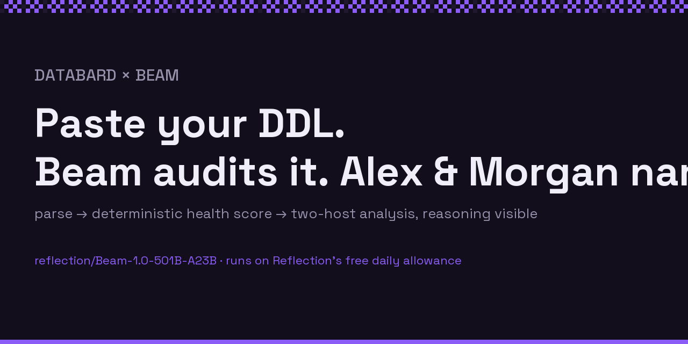

# Beam audits your database

Paste your DDL (or pick a featured dataset). **reflection/Beam-1.0-501B-A23B** parses it into a
schema, DataBard's production health rubric scores it deterministically, and Beam narrates a
two-host analysis — Alex (data advocate) and Morgan (quality auditor). **Beam's raw reasoning
stream is shown live**, so you can watch a 501B thinking model work.

Built for the [Beam × Hugging Face contest](https://huggingface.co/reflection/Beam-1.0-501B-A23B).



## Why this is interesting

- **Agentic structured output:** the parse stage asks Beam to turn raw DDL into a strict
  `SchemaMeta` JSON — no hand-written SQL parser.
- **Deterministic scoring:** health scores come from a Python port of DataBard's production
  rubric (`schema-analysis.ts`), not from the model — the numbers are reproducible and the LLM
  can't flatter them.
- **Visible reasoning:** Beam returns `reasoning_content` tokens; the Space streams them into a
  live "thoughts" panel and reports what share of the budget thinking consumed.

## Free-tier hygiene

This Space runs on **Reflection's free daily allowance**. Results are cached in-process and the
Space is rate-limited (shared daily cap + per-visitor cap). When the allowance is exhausted it
degrades to an honest card linking the frozen artifacts below — it never pretends.

## Companion artifacts

- **Benchmark:** [databard.persidian.com/benchmarks/beam](https://databard.persidian.com/benchmarks/beam)
  — Beam vs DataBard's production model on this exact workload, 24 graded runs.
- **Dataset:** [Papajams/agent-service-quality](https://huggingface.co/datasets/Papajams/agent-service-quality)
  — measured quality scores for 150+ pay-per-call agent services.
- **Product:** [databard.persidian.com](https://databard.persidian.com)

## Local development

```bash
pip install -r requirements.txt
REFLECTION_API_KEY=... python app.py
```

Fixtures under `fixtures/` are frozen byte-identical to DataBard's production prompts
(regenerate with `npx tsx scripts/export-beam-space-fixtures.mjs` in the main repo).
